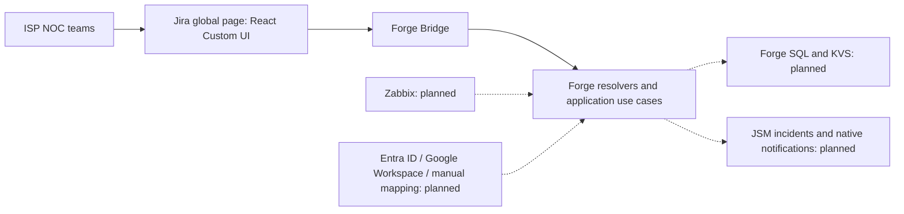

# Light House

**Light House — Network Incident Orchestration for Internet Service Providers, built on Atlassian Forge.**

Light House is a Codegeist 2026 project in **Apps for Specialized Industries**. ISP network operations teams need to turn monitoring alerts into accountable incidents: identify customer impact, keep SLA ownership visible, coordinate departmental handoffs and validate restoration before closure.

The objective is to bring this workflow into Jira Service Management (JSM), with Zabbix as the primary monitoring source and Atlassian authentication as the authority.

## Current implementation

The implemented foundation is a React Custom UI Jira global page, a Forge Bridge `getStatus` resolver, typed public metadata, an allowlisted structured logger and internally generated correlation IDs. Unit tests cover shell loading/failure, resolver behaviour and foundation contracts. Tests that mock Forge SDKs are local evidence.

The incident engine, Zabbix adapter, persistence layer, SLA engine, inventory, directory adapters and JSM incident creation are **planned, not functional**. The UI states that integrations are not connected and presents no operational metrics. See the [foundation acceptance report](docs/project/foundation-acceptance-report.md) for actual deployment, runtime and publication gates. Sprint 1 has not started.

## Planned incident workflow

Zabbix events → automated intake Border Control → network context enrichment → customer impact analysis → SLA calculation → JSM incident creation → accountable departmental handoffs → final restoration validation → guarded closure.

Border Control will authenticate, bound, deduplicate and route monitoring intake; unknown inventory will remain visible for manual triage. Recovery events will provide evidence rather than automatically close incidents. JSM will send native notifications. Entra ID and Google Workspace will map identities with a manual fallback; they will not replace Atlassian login. Zoho Desk is optional stretch scope.

## Architecture and system context



Only the page → Bridge → read-only status resolver path is implemented. `src/domain` has no Forge imports; `src/application` defines use cases and ports; infrastructure implements ports; `src/forge` owns trusted runtime wiring. Future tenant operations must validate installation membership and ISP tenant boundaries independently.

## Technology and repository structure

TypeScript, React 18, Forge Custom UI, Forge Functions/Resolvers and Forge Bridge; Vite/esbuild; Vitest, ESLint and Prettier. Planned persistence is Forge-native SQL/KVS. There is no separately hosted backend or runtime generative AI.

| Path                 | Purpose                                               |
| -------------------- | ----------------------------------------------------- |
| `src/domain`         | Domain contracts and public metadata                  |
| `src/application`    | Use cases and ports                                   |
| `src/infrastructure` | Port implementations                                  |
| `src/forge`          | Trusted Forge handlers and wiring                     |
| `static/app`         | React Custom UI                                       |
| `tests`              | Unit tests; future contract/integration gates         |
| `scripts`            | Local manifest verification                           |
| `docs`               | Architecture, ADRs, operations, tracking and evidence |

## Local development and testing

Use Node **22.23.4** from `.nvmrc`, npm **10.9.9**, and Forge CLI **16.0.0** for authenticated platform acceptance.

```sh
nvm use
npm ci
npm run validate
```

Validation runs ESLint, formatting, strict TypeScript, unit coverage, UI/backend builds and local manifest wiring. Individual commands are `npm run lint`, `npm run format:check`, `npm run typecheck`, `npm run test`, `npm run test:coverage`, `npm run build` and `npm run check:manifest`. `npm audit` is a separate security gate and currently fails; see [LH-014](docs/project/dependency-security-assessment.md). Do not use a force fix or silently downgrade SDKs.

The registered Forge application identity is preserved; do not register a duplicate. Fork users need their own owner-approved application registration rather than access to this app. Authenticated deployments and installations require explicit target authorisation. See [setup](docs/operations/development-setup.md) and [deployment](docs/operations/deployment.md). Optional agent skills are local tools, excluded from application code and CI.

## Roadmap

Foundation acceptance precedes Sprint 1 tenancy and synthetic inventory. Later sprints cover monitoring intake, enrichment/SLA, JSM lifecycle and handoffs, operational UI, identity mapping, recovery/security hardening, regression and demonstration. See the [backlog](docs/project/tracking.md) and [roadmap](docs/project/roadmap.md). No next sprint starts automatically.

## Security, cost and contributions

Use synthetic data only. Report vulnerabilities through the private process in [SECURITY.md](SECURITY.md); do not put credentials or customer payloads in issues. Follow [CONTRIBUTING.md](CONTRIBUTING.md) and [AGENTS.md](AGENTS.md).

The minimal scaffold uses a bounded status invocation and allowlisted log with no persistence, polling or external calls. Forge included allowances are not hard spending caps or a guarantee of permanent free Atlassian product licensing. See [cost governance](docs/operations/cost-governance.md).

**Project licence: awaiting owner decision.** Source visibility does not grant an open-source licence. Third-party packages retain their own terms; see [dependency and licence review](docs/project/dependency-security-assessment.md). Public source publication does not authorise public Forge application distribution.

## Technical documentation

[Requirements](docs/project/requirements.md) · [Architecture](docs/project/architecture.md) · [System context](docs/architecture/system-context.md) · [ADRs](docs/adr/README.md) · [Acceptance criteria](docs/project/acceptance-criteria.md) · [Audit](docs/project/audit.md) · [Submission checklist](docs/hackathon/submission-checklist.md)
