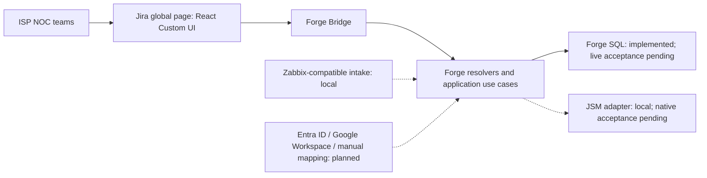

# Light House

[](https://github.com/FRANKD-UX/light-house/actions/workflows/ci.yml)

**Light House — Network Incident Orchestration for Internet Service Providers, built on Atlassian Forge.**

Light House is a Codegeist 2026 project in **Apps for Specialized Industries**. ISP network operations teams need to turn monitoring alerts into accountable incidents: identify customer impact, keep SLA ownership visible, coordinate departmental handoffs and validate restoration before closure.

The objective is to bring this workflow into Jira Service Management (JSM), with Zabbix as the primary monitoring source and Atlassian authentication as the authority.

## Current implementation

Sprint 1 provides server-authorised ISP tenancy, Forge SQL inventory, manual teams/assignees, bounded mutation repair and synthetic fixtures. Local Sprint 2–4 work adds authenticated Zabbix-compatible intake, durable inbox/deduplication, infrastructure/customer impact, immutable SLA decisions, idempotent JSM request creation and operational ownership/handoff/checklist controls. The React workspace displays impact, SLA and durable Jira linkage. These paths have local SQLite, mocked SDK/HTTP and Bridge tests; they are not all verified natively.

**Deployment is not complete runtime acceptance.** The existing DEVELOPMENT installation is on major4 from implementation `2b97545`; its exact health UUID is accepted. Deployment used `--no-verify` after separate owner-reported authenticated lint, recorded transparently. Newer local incident/operations code, scopes and v003/v004/v005 schemas are **not deployed**. Real Zabbix/Jira end-to-end acceptance, verified Jira transitions/closure, reassignment, scheduled warnings, full dashboard/context, directory integrations and mandatory release gates remain outstanding. Sprint1 is implementation-complete locally with release acceptance outstanding; its native migration/readiness and eleven-kind retrieval evidence are preserved.

See the [programme continuation state](docs/project/autonomous-execution-state.md), [local operational preparation](docs/operations/local-operational-acceptance.md), [deployed Sprint2 acceptance procedure](docs/operations/sprint-2-hosted-acceptance.md) and [current security assessment](docs/project/programme-security-assessment.md). Read-only browser harness details remain in [e2e/README.md](e2e/README.md); its pinned hosted target must not be widened to exercise mutations.

## Planned incident workflow

Zabbix events → automated intake Border Control → network context enrichment → customer impact analysis → SLA calculation → JSM incident creation → accountable departmental handoffs → final restoration validation → guarded closure.

Border Control will authenticate, bound, deduplicate and route monitoring intake; unknown inventory will remain visible for manual triage. Recovery events will provide evidence rather than automatically close incidents. JSM will send native notifications. Entra ID and Google Workspace will map identities with a manual fallback; they will not replace Atlassian login. Zoho Desk is optional stretch scope.

## Architecture and system context



The page → Bridge → status and inventory resolvers are implemented. Inventory persistence requires the explicit development SQL migration and installation consent upgrade. `src/domain` has no Forge imports; `src/application` defines use cases and ports; infrastructure implements ports; `src/forge` owns trusted runtime wiring. Future tenant operations must validate installation membership and ISP tenant boundaries independently.

## Technology and repository structure

TypeScript, React 18, Forge Custom UI, Forge Functions/Resolvers and Forge Bridge; Vite/esbuild; Vitest, ESLint and Prettier. Relational persistence uses Forge SQL; KVS secrets remain reserved for later credentials. There is no separately hosted backend or runtime generative AI.

| Path                 | Purpose                                               |
| -------------------- | ----------------------------------------------------- |
| `src/domain`         | Domain contracts and public metadata                  |
| `src/application`    | Use cases and ports                                   |
| `src/infrastructure` | Port implementations                                  |
| `src/forge`          | Trusted Forge handlers and wiring                     |
| `static/app`         | React Custom UI                                       |
| `tests`              | Unit tests; future contract/integration gates         |
| `scripts`            | Local manifest verification                           |
| `e2e`                | Isolated read-only hosted Playwright acceptance       |
| `docs`               | Architecture, ADRs, operations, tracking and evidence |

## Local development and testing

Use Node **22.23.4** from `.nvmrc`, npm **10.9.9**, and Forge CLI **16.0.0** for authenticated platform acceptance.

```sh
nvm use
npm ci
npm run validate
```

Validation runs ESLint, formatting, strict TypeScript, unit coverage, UI/backend builds and local manifest wiring. Individual commands are `npm run lint`, `npm run format:check`, `npm run typecheck`, `npm run test`, `npm run test:coverage`, `npm run build` and `npm run check:manifest`. `npm audit` is a separate security gate and currently fails; see [LH-014](docs/project/dependency-security-assessment.md). Do not use a force fix or silently downgrade SDKs.

For automated native acceptance, install the isolated tooling once and complete owner login/MFA in the opened browser:

```sh
npm ci --prefix e2e
export LIGHT_HOUSE_E2E_BROWSER_CHANNEL=chrome
npm run test:e2e:doctor
npm run test:e2e:auth
npm run test:e2e:development
npm run test:e2e:report
```

Installed Google Chrome Stable is the default browser; developers/CI can explicitly select sandbox-capable `chromium` as documented in the E2E runbook. Use `npm run test:e2e:development:headed` for a visible browser. The suite automates health/readiness and sites/carriers/SLA-tier reads, including available next pages, with no data mutation. Session state and curated JSON/HTML reports remain in gitignored, owner-only `e2e/.local/`; screenshots/traces are disabled. `npm run test:e2e:check` runs credential-free harness tests in CI; `npm run test:e2e:fixture` checks the reader against a local synthetic browser fixture. Keep the Forge tunnel stopped. See the [E2E runbook](e2e/README.md) for target restrictions, evidence limits and exact setup/recovery commands.

The registered Forge application identity is preserved; do not register a duplicate. Fork users need their own owner-approved application registration rather than access to this app. Authenticated deployments and installations require explicit target authorisation. See [setup](docs/operations/development-setup.md) and [deployment](docs/operations/deployment.md). Optional agent skills are local tools, excluded from application code and CI.

## Roadmap

Foundation acceptance is verified; Sprint 1 tenancy and synthetic inventory are implemented locally with live gates outstanding. Later sprints cover monitoring intake, enrichment/SLA, JSM lifecycle and handoffs, operational UI, identity mapping, recovery/security hardening, regression and demonstration. See the [backlog](docs/project/tracking.md) and [roadmap](docs/project/roadmap.md). No next sprint starts automatically.

## Security, cost and contributions

Use synthetic data only. Report vulnerabilities through the private process in [SECURITY.md](SECURITY.md); do not put credentials or customer payloads in issues. Follow [CONTRIBUTING.md](CONTRIBUTING.md) and [AGENTS.md](AGENTS.md).

Inventory uses indexed tenant predicates, explicit four-record seed batches and bounded durable repair intents. There is no automatic polling or migration on page load. Jira global-administration checks run server-side in user context; no external egress is declared. Forge included allowances are not hard spending caps or a guarantee of permanent free Atlassian product licensing. See [cost governance](docs/operations/cost-governance.md).

**Project licence: awaiting owner decision.** Source visibility does not grant an open-source licence. Third-party packages retain their own terms; see [dependency and licence review](docs/project/dependency-security-assessment.md). Public source publication does not authorise public Forge application distribution.

## Technical documentation

[Requirements](docs/project/requirements.md) · [Architecture](docs/project/architecture.md) · [System context](docs/architecture/system-context.md) · [ADRs](docs/adr/README.md) · [Acceptance criteria](docs/project/acceptance-criteria.md) · [Audit](docs/project/audit.md) · [Submission checklist](docs/hackathon/submission-checklist.md)
