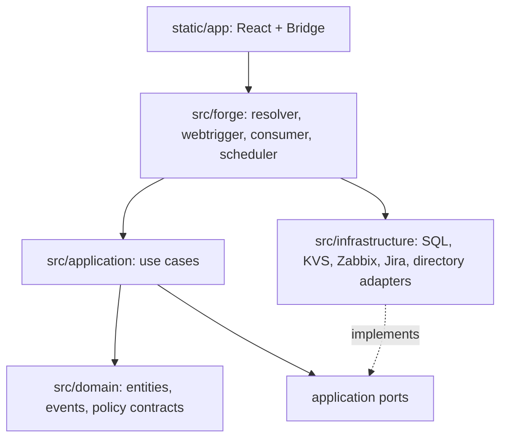

# Component model

Domain code has no Forge SDK dependencies. Application ports accept trusted context and normalised data; raw external values remain unknown until adapter validation. Infrastructure implements REST/persistence/security concerns. Forge handlers derive trusted context and wire services. UI may import safe public types/metadata, never infrastructure code or credentials.

Implemented: `index.handler` → status resolver → `getStatus`, structured logger and generated correlation ID. `TenantContext`, `MonitoringAdapter`, normalised event and error contracts establish boundaries only. No persistence, scheduling, queue, webhook or external API classes are scaffolded as pretend functionality. Add directories only when they contain implementation or useful design material.

Sprint 0.5 design: operational state machine/gate evaluation, impact and SLA remain in domain/application services; authentication, actor derivation, tenant authorisation and wiring remain in Forge boundaries. Adapters handle Jira/Zabbix/SQL delivery and normalisation without choosing operational transitions. Only the read-only scaffold is implemented. See ADR-0015 and event-lifecycle.md.
