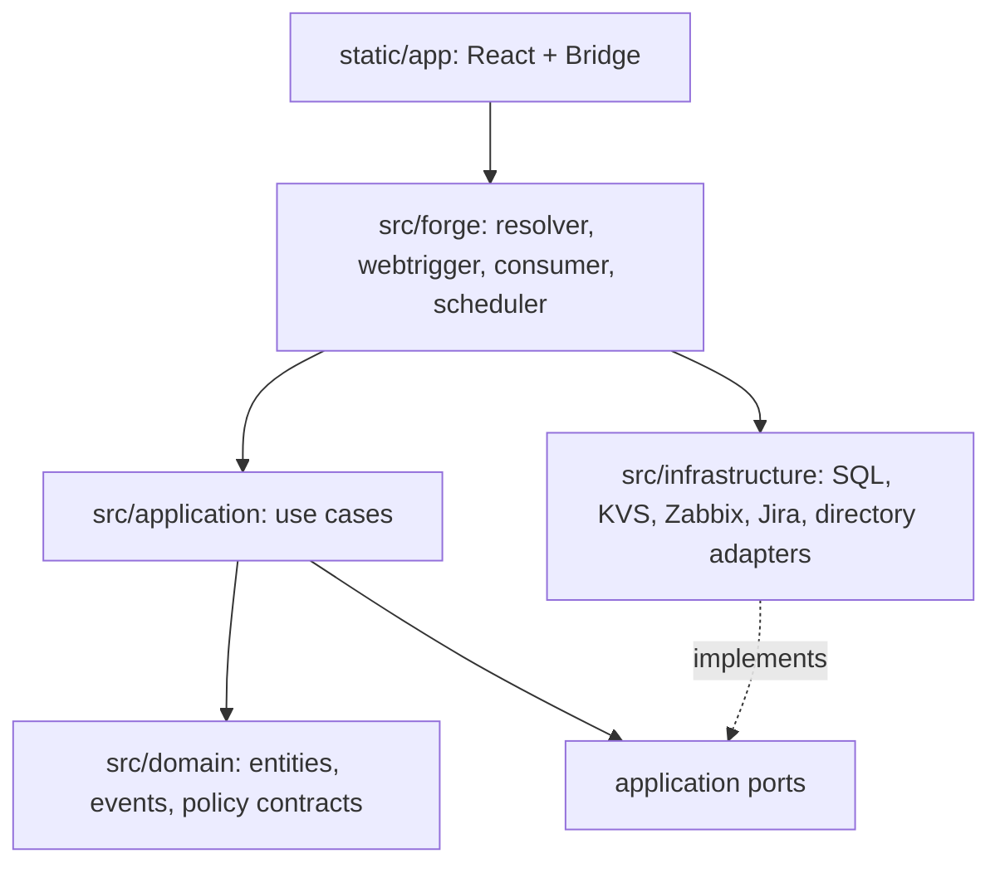

# Component model

## Current implementation status — 2026-11-28

Local checkpoint d35a6c8 now includes SQL inventory/monitoring, authenticated static webtrigger/consumer, incident enrichment/SLA, JSM creation ports/adapters, bounded catch-up, durable operational commands and current-page NOC UI. Independent native transition service/SQL adapter/v006 and read-only terminal discovery are subsequent local work, not registered native closure. Deployed major4 remains Sprint2; no later runtime or migration is natively accepted. Directory adapters, embedded Jira context and remaining roadmap functionality remain open. Earlier scaffold-only paragraphs describe historical checkpoints.

Domain code has no Forge SDK dependencies. Application ports accept trusted context and normalised data; raw external values remain unknown until adapter validation. Infrastructure implements REST/persistence/security concerns. Forge handlers derive trusted context and wire services. UI may import safe public types/metadata, never infrastructure code or credentials.

Historical Sprint0 implementation: `index.handler` → status resolver → `getStatus`, structured logger and generated correlation ID. `TenantContext`, `MonitoringAdapter`, normalised event and error contracts establish boundaries only. No persistence, scheduling, queue, webhook or external API classes are scaffolded as pretend functionality. Add directories only when they contain implementation or useful design material.

Sprint 0.5 design: operational state machine/gate evaluation, impact and SLA remain in domain/application services; authentication, actor derivation, tenant authorisation and wiring remain in Forge boundaries. Adapters handle Jira/Zabbix/SQL delivery and normalisation without choosing operational transitions. At that checkpoint only the read-only scaffold was implemented. See ADR-0015 and event-lifecycle.md.

## Sprint 1 runtime investigation — 2026-11-26

Status and inventory currently share the index/module dependency graph with SQL/API/events and migration registration. Initialization only constructs SDK clients/resolver and enqueues DDL descriptions in memory; migration execution is explicit. Local real-SDK health dispatch and a saved Forge bundle serialize status successfully; no backend import split is justified as an incident fix without runtime evidence. UI diagnostics distinguish reported invocation rejection, handled backend failure and invalid response; categories are projected locally and raw exception text is never displayed/logged. See the [investigation](../operations/sprint-1-live-acceptance.md#focused-runtime-investigation-and-corrective-action--2026-11-26) for evidence limits and source links. No change to tenancy, DDL, API or deployment authorisation.

Inventory list lifecycle diagnostics use an application-owned port with a no-op default; Forge wiring supplies the structured implementation for list requests only. SQL repositories receive the same request-scoped diagnostic instance. Domain code remains Forge-free; application imports no infrastructure. Safe sink projection strips arbitrary diagnostic fields. No new UI action or SQL endpoint is introduced by this instrumentation.

## Sprint 1 native acceptance harness — 2026-11-26

`e2e/` is an isolated development tool, outside application TypeScript/Vitest/runtime entrypoints. Owner-authenticated Playwright → hosted Jira page → uniquely identified rendered Custom UI → ordinary button actions → existing Forge Bridge/resolver/SQL. The tool does not import backend code, intercept Bridge responses or call application endpoints directly. A separate supported Forge CLI log read projects only allowlisted diagnostics into private curated JSON/HTML reports. Exact displayed UUID matches and temporal candidates have separate labels. Local synthetic browser fixtures validate harness behaviour only; actual hosted execution remains an independent acceptance gate. No application/module/resource/authentication architecture changes.

## Embedded context — local Sprint5

A dedicated static issue-context resource and resolver expose only a linked-incident read. Server context supplies account/installation/issue/project candidates; interactive asUser GET confirms exact Jira visibility/project, SQL reverse lookup supplies tenant, and final active/readgrant/expiry/nonpending predicates authorise projection. No UI selectors grant access, no new scope/egress/SQLwrite is introduced. Public globalworkspace remains separate. Nativehostcontext/modulekeycompatibility, theme/layout and permissions await acceptance; no deployment performed.
