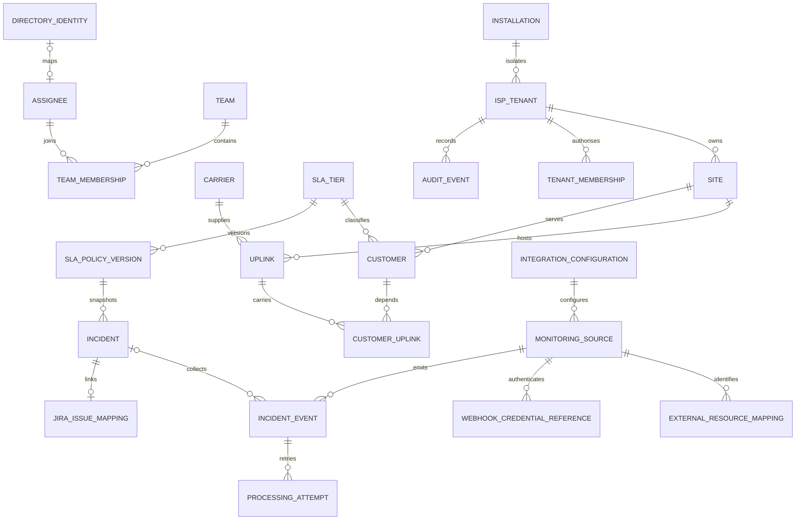

# Logical data model — design only

No tables or migrations are implemented in Sprint 0. All entities below belong to one Forge installation. Except installation metadata, every primary key is `(tenant_id, id)`; ISP tenant uses `id` as tenant identity. IDs are internally generated opaque UUIDs, never inferred from a hostname, email or customer name. Every mutable record requires UTC `created_at`, `updated_at`, `version` and explicit `status`; immutable events/policy versions require `created_at` and status/outcome only. Null means unknown, never zero. Required references must exist in the same tenant before acceptance.

`U(...)` means a unique index, `I(...)` a secondary index; each implied index is prefixed with tenant_id. PK is also indexed. Listed parent references are logical relationships enforced by application services, not foreign keys. All string identifiers are length bounded; unique/index design must be checked against SQL collation and index byte limits in Sprint 1. External IDs must preserve case unless a provider defines canonicalisation. Store UTC as validated ISO strings at boundaries and a consistently converted supported SQL type; never depend on implicit local time conversion.

Retention defaults are proposed, need owner approval, and are not implemented: inventory/mappings soft-retire and retain 90 days after last incident reference; incidents, SLA snapshots, lifecycle and audit events 180 days; processing attempts and replay receipts 30 days after terminal state; quarantine payloads at most 7 days, sanitised; credential material deleted immediately after rotation grace/revocation. Retain minimal duplicate tombstones for 180 days; older replay is rejected/manual review rather than creating an incident. Deletion must respect legal/user deletion requirements and documented Forge installation data lifecycle; do not promise indefinite availability after uninstall.

Classifications: Internal = synthetic topology/operations configuration; Restricted = person/customer relationships or identifiers; Secret = credentials (KVS only). Installation boundary is Forge-owned; ISP tenant is app-owned. Jira IDs are mappings, not tenant identity.

| Entity / primary identifier                   | Required attributes and tenant ownership                                                                                                                                 | Optional attributes                                                                                  | Relationships                                                                     | Unique constraints and indexes                                                                                                              | Lifecycle / retention / security                                                                                                |
| --------------------------------------------- | ------------------------------------------------------------------------------------------------------------------------------------------------------------------------ | ---------------------------------------------------------------------------------------------------- | --------------------------------------------------------------------------------- | ------------------------------------------------------------------------------------------------------------------------------------------- | ------------------------------------------------------------------------------------------------------------------------------- |
| Installation metadata / Forge installation ID | platform-owned installation identity; schema version, environment, readiness                                                                                             | consent revision, last migration outcome                                                             | owns ISP tenants and SQL database                                                 | U(installation_id); I(readiness) in installation metadata only                                                                              | provisioning/ready/failed/uninstalled; platform lifecycle; Internal                                                             |
| ISP tenant / id                               | installation binding, name, slug, default unknown-impact policy                                                                                                          | support label, default team_id                                                                       | owns all tenant rows                                                              | U(slug); I(status)                                                                                                                          | draft/active/suspended/retired; retire after dependent data; Internal                                                           |
| Site / id                                     | tenant_id, code, display_name                                                                                                                                            | region, timezone display hint, description                                                           | tenant; customers, uplinks                                                        | U(code); I(status, code)                                                                                                                    | active/maintenance/retired; inventory retention; Internal                                                                       |
| Uplink / id                                   | tenant_id, site_id, carrier_id, code, role(primary/backup), capacity_mbps                                                                                                | protected_uplink_id, circuit alias                                                                   | site and carrier; backup may protect primary in same site                         | U(site_id, code); I(site_id, status); I(carrier_id)                                                                                         | active/degraded/down/retired; inventory retention; Internal                                                                     |
| Carrier / id                                  | tenant_id, code, display_name                                                                                                                                            | support reference (no credential), contact label                                                     | uplinks                                                                           | U(code); I(status)                                                                                                                          | active/retired; retain while uplink referenced; Internal                                                                        |
| Customer / id                                 | tenant_id, synthetic reference, display alias, site_id, sla_tier_id                                                                                                      | service class; no real contacts in demo                                                              | site, SLA tier; service dependencies via customer_uplinks                         | U(reference); I(site_id, status); I(sla_tier_id)                                                                                            | active/suspended/retired; 90 days after unlink and references expire; Restricted                                                |
| Customer-uplink dependency / id               | tenant_id, customer_id, uplink_id, service_id, dependency_mode                                                                                                           | failover group                                                                                       | customer + uplink                                                                 | U(customer_id, uplink_id, service_id); I(uplink_id, customer_id)                                                                            | active/retired; inventory retention; Restricted                                                                                 |
| Team / id                                     | tenant_id, code, name                                                                                                                                                    | escalation label                                                                                     | assignees through team_memberships                                                | U(code); I(status)                                                                                                                          | active/retired; inventory retention; Internal                                                                                   |
| Assignee / id                                 | tenant_id, atlassian_account_id, display alias, mapping_method                                                                                                           | directory_identity_id                                                                                | Atlassian identity; memberships, incident assignment                              | U(atlassian_account_id); I(status)                                                                                                          | active/unmapped/disabled; minimise person data, 90 days after unlink; Restricted                                                |
| Team membership / id                          | tenant_id, team_id, assignee_id, role                                                                                                                                    | effective_until                                                                                      | same-tenant team + assignee                                                       | U(team_id, assignee_id); I(assignee_id, status)                                                                                             | active/expired/revoked; 90 days; Restricted                                                                                     |
| Directory identity / id                       | tenant_id, provider(entra/google/manual), directory_tenant_id, external_subject_id                                                                                       | display alias, verified mapping timestamp                                                            | optional assignee binding, integration config                                     | U(provider, directory_tenant_id, external_subject_id); I(status)                                                                            | discovered/mapped/disabled; 90 days after unmap; Restricted                                                                     |
| Tenant membership / id                        | tenant_id, Atlassian accountId, role(viewer/operator/admin), granted_by                                                                                                  | expires_at                                                                                           | app access grant; independent from directory identity                             | U(account_id); I(role, status)                                                                                                              | active/revoked/expired; 180 day audit, delete stale grant; Restricted                                                           |
| Monitoring source / id                        | tenant_id, type, name, integration_config_id                                                                                                                             | external instance reference, tested version                                                          | source owns credentials and resource mappings                                     | U(name); I(type, status)                                                                                                                    | draft/active/disabled/compromised; inventory retention; Internal                                                                |
| External resource mapping / id                | tenant_id, source_id, external_resource_id, resource_kind(site/uplink), internal_resource_id                                                                             | valid_from, valid_until, label                                                                       | one active mapping to same-tenant topology                                        | U(source_id, external_resource_id, resource_kind); I(internal_resource_id, resource_kind)                                                   | active/unmapped/retired; retain historical mapping snapshots in incidents; Internal                                             |
| SLA tier / id                                 | tenant_id, code, name                                                                                                                                                    | service description                                                                                  | customers; policy versions                                                        | U(code); I(status)                                                                                                                          | draft/active/retired; retain while snapshots referenced; Internal                                                               |
| SLA policy version / id                       | tenant_id, tier_id, version_number, effective_from, priority_map, P1/P2/P3 duration_seconds and warning_seconds, unknown_impact_rule                                     | effective_until, approved_by                                                                         | immutable tier version; incident snapshots reference version                      | U(tier_id, version_number); I(tier_id, effective_from)                                                                                      | draft/published/superseded; 180 days after final reference; Internal                                                            |
| Incident / id                                 | tenant_id, source_id, problem_event_id, site_id or explicit unknown marker, operational_state, impact_known, affected_customer_count(nullable), occurred_at, received_at | uplink_id, carrier/team/assignee snapshots, resolved_at, reopened_from_id, SLA snapshot, next_due_at | many events, attempts, issue mapping; SLA snapshot immutable                      | U(source_id, problem_event_id); I(operational_state, next_due_at); I(site_id, occurred_at)                                                  | pending/active/recovery-detected/resolution-pending/resolved/reopened/manual-review; 180 days; Restricted aggregate             |
| Incident event / id                           | tenant_id, source_id, external_event_id, kind, problem_event_id, idempotency_digest, occurred_at, received_at, processing_state, normalised payload, enqueue_state       | incident_id, lease_owner/until, safe error code, retry_after, quarantined payload reference          | incident optional until enriched; source mandatory                                | U(idempotency_digest); U(source_id, external_event_id, kind); I(processing_state, retry_after); I(source_id, problem_event_id, occurred_at) | received through complete/retry/manual-review; sanitised payload 7 days, normalised history 180 days; Restricted                |
| Jira issue mapping / id                       | tenant_id, incident_id, project_id, issue_id, issue_key, reconciliation_marker                                                                                           | request_type_id, service_desk_id, last_synced_at                                                     | one primary JSM incident issue                                                    | U(incident_id); U(issue_id); U(reconciliation_marker); I(project_id, issue_key)                                                             | intent/linked/ambiguous/unlinked/archived; 180 days with incident; Internal                                                     |
| Integration configuration / id                | tenant_id, provider, name, schema_version, nonsecret_config, enabled                                                                                                     | credential_ref_id, health_code, last_verified_at                                                     | monitoring/directory/support adapters; JSM config project/request type references | U(provider, name); I(provider, status)                                                                                                      | draft/validated/active/disabled; inventory retention; Internal, no tokens                                                       |
| Webhook credential reference / id             | tenant_id, source_id, public_key_id, secret_store_key, valid_from, expires_at                                                                                            | previous_credential_id, grace_until, revoked_at                                                      | monitoring source; KVS key includes tenant/source/ref                             | U(public_key_id) installation-wide; U(source_id, secret_store_key); I(source_id, status, expires_at)                                        | pending/active/rotating/revoked/expired; metadata 180 days, material removed after grace; Restricted reference, Secret material |
| Processing attempt / id                       | tenant_id, event_id, attempt_number, step, started_at, correlation_id, outcome                                                                                           | finished_at, next_retry_at, safe_error_code, integration_intent_marker                               | incident event                                                                    | U(event_id, attempt_number, step); I(outcome, next_retry_at)                                                                                | running/succeeded/failed/ambiguous/abandoned; 30 days terminal; Internal                                                        |
| Audit event / id                              | tenant_id, actor_kind/id, action, resource_kind/id, occurred_at, correlation_id, safe change summary                                                                     | before/after version, reason code                                                                    | append-only references; no secret snapshots                                       | U(id); I(resource_kind, resource_id, occurred_at); I(actor_id, occurred_at)                                                                 | recorded/exported/purge-eligible; 180 days proposed; Restricted                                                                 |

## Relationship diagram

All non-installation entities also have the ISP ownership relationship even where omitted for diagram readability. Validate mapping resource kind, backup cycles, overlapping policy intervals and same-tenant membership explicitly. Unique indexes alone cannot prevent interval overlap. Publish policy versions with a single version-checked tier pointer/update after validating candidate intervals; workers load the published policy effective at event occurrence and retain it once assigned. Historical policy and topology snapshots protect prior incidents from later edits. Unknown site/impact enters manual review; do not invent zero affected customers.

For impact, count distinct active customer/service identities according to documented dependency/failover rules; a primary failure with a healthy adequate backup may be degraded rather than disconnected. Preserve raw potentially affected versus confirmed affected counts and confidence in snapshots; do not sum customer rows across overlapping uplinks. The first implementation must explicitly state its simplified failover assumptions.

Application reference checks, optimistic concurrency, inbox dispatch and repair of missing secondary writes are specified in [persistence](persistence.md). Cross-record integrity is eventual across independent statements. No schema deployment, database constraints or runtime concurrency tests have yet been executed.
