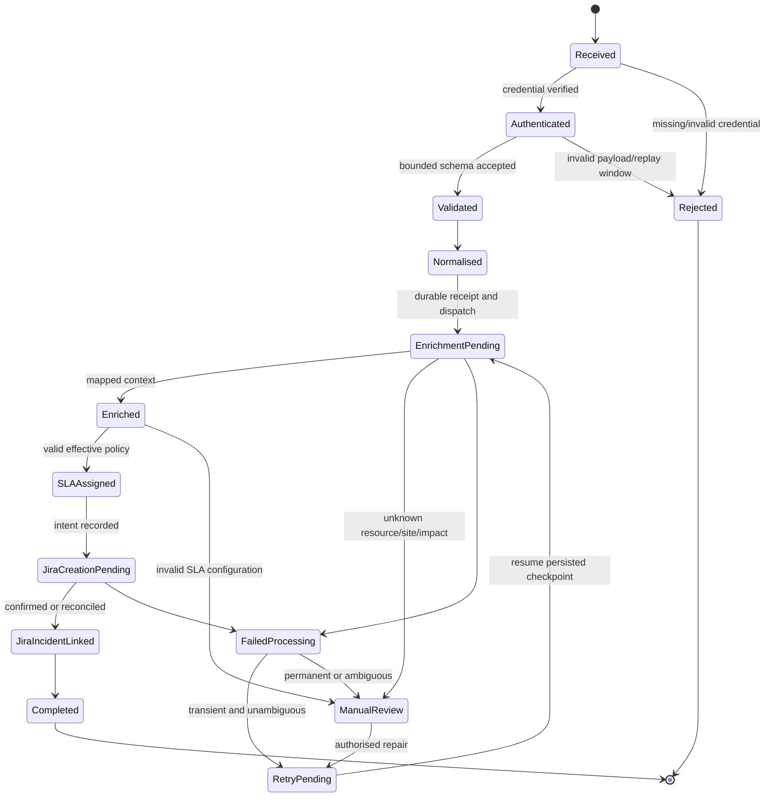
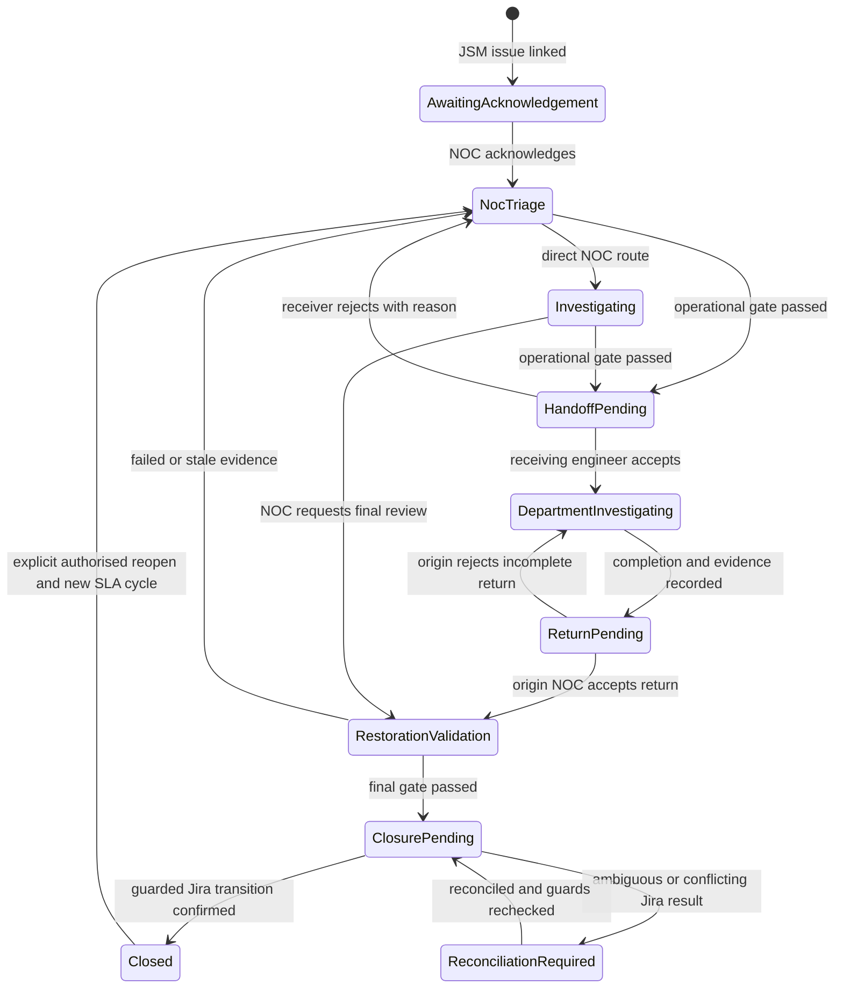

# Event processing and operational lifecycle

Design only. Delivery is at-least-once within documented retention, not exactly-once. The durable ledger is the source of processing truth, while Jira and Light House operational status need reconciliation.

Authenticated is a security decision before durable payload processing, not an incident state. Recovery/update events run a branch that loads the same problem aggregate and applies lifecycle transitions; they do not create another problem issue. Resume retries at the saved step, never rerun external writes blindly.

The authoritative operational graph and gates are defined below under Sprint 0.5; recovery evidence is independent of stage.

## Identity and ordering

Idempotency digest = SHA-256 of a canonical JSON tuple `[schemaVersion, tenantId, monitoringSourceId, externalEventId, eventKind]`. Tenant/source come from trusted credential configuration; event identifiers must be stable and length bounded. A recovery has its own stable event ID plus original problem ID; lifecycle aggregate key is `(tenant, source, problemEventId)`. Do not use message text, arrival time, delimiter concatenation, severity or credential version as identity. Rotation must not change event identity. Canonical tuple rules and digest collision handling need contract tests in Sprint 2.

A unique ledger insert suppresses duplicate delivery; subsequent handlers return the existing receipt without re-enrichment or Jira creation. Repeated problem notifications with new notification IDs must map to the stable problem event ID: append an update, retaining one incident and original SLA snapshot. Without trustworthy stable identity reject/manual-review rather than guess. Queue concurrency keys reduce parallel work; optimistic aggregate claims and unique keys remain authoritative.

## Failure and edge-case decisions

| Condition                             | Required behaviour / verification                                                                                                                                                                                                                                |
| ------------------------------------- | ---------------------------------------------------------------------------------------------------------------------------------------------------------------------------------------------------------------------------------------------------------------- |
| Concurrent duplicate events           | One ledger key, conditional lease/version claim; others read receipt. Stress test with overlapping workers.                                                                                                                                                      |
| Recovery before problem processing    | Persist recovery against problem ID; wait for enrichment, create contextual JSM record if policy requires, then require final validation and guarded closure. Never silently drop outage history.                                                                |
| Out-of-order update/recovery          | Compare source event time/type and aggregate revision; preserve event history. Late problem cannot reactivate a recovered aggregate automatically. Implausible/future timestamps require review.                                                                 |
| Jira create timeout / connection loss | Mark outcome ambiguous with intent marker. Search/reconcile before any retry; see below.                                                                                                                                                                         |
| Jira 429                              | Honour Retry-After, bounded backoff/jitter within retention, persist due time; do not block ingress.                                                                                                                                                             |
| Jira 400/401/403                      | Permanent configuration/permission failures to review; safe code only. No infinite retry.                                                                                                                                                                        |
| Partial integration failure           | Required JSM step remains incomplete; optional Zoho retry never undoes resolution. Repair missing mapping/audit writes from stable intent.                                                                                                                       |
| Unmapped resource / unknown site      | Retain authenticated receipt in visible manual triage; preserve unknown context/impact, accountable NOC ownership and original SLA start. Mapping repair/replay must be same-tenant and idempotent; do not discard or require complete inventory for visibility. |
| Unknown customer impact               | Count is null with reason; apply explicit unknown-impact priority policy or manual review. Never treat unknown as zero.                                                                                                                                          |
| Invalid/missing effective SLA         | Block Jira creation by default pending operator policy repair; record error and configuration version.                                                                                                                                                           |
| Manual resolution                     | Require final restoration gate and authorised guarded closure, verify Jira workflow permissions; record actor/reason and confirmed resolution UTC timestamp. Further repeat problem notices cannot reopen automatically.                                         |
| Reopen / new outage                   | Same event requires explicit authorised reopen with separate SLA cycle snapshot; a new stable problem ID creates a new incident. Historical resolved snapshot is immutable.                                                                                      |
| Queue loss / exhausted retry          | Sweep ledger for stalled/undispatched states with bounded pages and attempt budget. Exhausted/ambiguous work becomes visible manual review.                                                                                                                      |
| Replay after retention                | Reject stale timestamps or require reviewed replay mode; minimal tombstones prevent duplicate new incidents.                                                                                                                                                     |

## Ambiguous Jira creation reconciliation

Persist an integration intent marker derived from internal incident ID before POST. Include it in a supported field on the initial create request (proposed dedicated marker custom field or exact token in description); adding a property only after creation is insufficient. Sprint 4 must verify which request fields are available for the selected JSM request type and which are searchable. Search within the configured project, candidate creation window and marker, then fetch candidate content and compare the complete marker. Eventually consistent search returning zero is not proof of failure.

If exactly one verified match exists, link it using the unique incident/issue mapping. Multiple matches need operator review. No match after repeated bounded checks still requires review or independently conclusive failed-create evidence before releasing another create attempt. Never automatically retry an unknown-outcome POST just because its lease expired. A confirmed pre-submission validation rejection can be corrected and retried. This trades some automation for preventing duplicate customer incidents without claiming external idempotency.

Duplicate-event suppression handles repeated identities only. Topology-aware correlation of several distinct uplink/site alerts is an optional later feature and must not be claimed by the MVP.

## Sprint 0.5 operational workflow — authoritative design

ADR-0015 supersedes the coarse Sprint 0 lifecycle with this fixed MVP state model; the processing diagram remains independent. All stages are design only. Monitoring recovery is an orthogonal evidence flag and never advances these stages on its own.

### Ordered baseline and three gates

1. Receive monitoring event and resolve installation/source/tenant through credential binding.
2. Automated Border Control: authentication, byte/schema/time/replay checks, stable identity and durable duplicate control. Invalid security/payload inputs are rejected safely. Legitimate authenticated events with incomplete inventory go to visible manual triage, retaining a receipt and original timestamps.
3. Normalise through monitoring port.
4. Enrich network/site/uplink/carrier context, preserving explicit unknowns.
5. Calculate distinct customer/service impact with confidence and missing-data reasons.
6. Assign versioned P1/P2/P3 SLA and warnings; an absent policy is a visible configuration blocker with original start retained, never a silent drop or reset.
7. Create/link JSM incident, including a conservative unknown-context route if site/request configuration permits. If required fields/configuration block creation, expose the durable intake in the command centre until repair.
8. NOC engineer acknowledges and becomes accountable under the current NOC team.
9. NOC triages diagnostics, impact and outstanding actions.
10. Operational Border Control evaluates a bounded checklist: diagnostic findings, escalation justification, safe supporting evidence, receiving-team capability, accountable origin engineer and named outstanding actions. Missing required items deny handoff with actionable safe reasons.
11. Request a handoff only where necessary; origin retains accountability while pending.
12. Receiver accepts or rejects. Acceptance atomically changes accountable ownership; rejection requires a reason and retains origin ownership. Retired teams, inactive engineers and cross-tenant references are denied.
13. Current owner investigates/remediates. Direct NOC resolution skips departmental states entirely.
14. Department completes work and requests return to originating NOC with evidence/actions; receiver remains accountable until NOC accepts. Rejected returns go back for work; history remains immutable.
15. Final restoration gate requires NOC review of monitoring recovery or explicit alternative diagnostics, service/customer impact reassessment, completion or explicitly approved disposition of outstanding actions, and recorded validator/time/evidence. A recovery flag alone cannot pass. Proposed MVP validator is an authorised NOC engineer; independent second-person approval is an owner policy decision, not an assumed feature.
16. Guarded closure checks current incident revision, fresh final validation, no active/pending handoff, accountable owner, Jira permissions and allowed transition. Persist close intent, confirm/reconcile Jira result, then record closure. A Jira timeout never proves closure. SLA continues until confirmed operational resolution; preserve restoration evidence time separately.
17. Optional Zoho follow-up runs after closure via separate deduplicated intent; failure never reopens the incident or blocks closure.

### Transition concurrency and audit

Commands accept unknown input at Forge boundary; server derives actor and tenant membership, loads the incident, validates role/team membership, expected version and same-tenant references, then evaluates the code-defined transition and gate version. The client cannot set actor, ownership, SLA clocks, gate pass or timestamps. Server UTC/correlation IDs are generated internally. Evidence is bounded escaped text plus authorised Jira attachment references; no arbitrary URL fetch.

A single conditional incident write carries state, owner, active handoff pointer, last-command ID and a bounded pending audit/outbox envelope. Repeating the same command returns its recorded result; a stale different command fails with conflict. Materialise handoff/validation/audit records idempotently from that envelope, then clear it conditionally. Block another mutation while required materialisation is incomplete and use bounded repair; do not claim atomic multi-table SQL writes. Jira side effects have separate persisted intent/outcome and reconciliation. Sprint 1 verifies the storage primitive; Sprints 3/4 implement behaviour.

### Attribute and workflow ownership matrix

| Attribute / action                                              | Authority                                                         | Light House / Jira interaction and conflict handling                                                                                                                                         |
| --------------------------------------------------------------- | ----------------------------------------------------------------- | -------------------------------------------------------------------------------------------------------------------------------------------------------------------------------------------- |
| Raw problem/recovery identity/time                              | Zabbix source                                                     | Adapter validates; ledger immutable; source cannot select tenant or close an incident.                                                                                                       |
| Authentication, delivery, normalisation                         | Forge integration boundary                                        | Trusted source configuration and durable receipts; adapters do not decide workflow.                                                                                                          |
| Network topology, service dependencies, impact                  | Light House domain                                                | Versioned inventory and impact snapshots; Jira receives safe summaries.                                                                                                                      |
| Operational stage, gates, handoff and team owner                | Light House server                                                | Jira fields/status are mirrors; only guarded commands advance the app workflow.                                                                                                              |
| Engineer assignment                                             | Light House accountable owner; Jira owns native assignee validity | Validate account is active/assignable and same-tenant team member before sync. Native assignment edits become reviewed proposals/drift, never silent operational transfer.                   |
| Issue key, native status/resolution and transition availability | Jira/JSM                                                          | App requests configured transitions; read confirmed result. Unsolicited Jira resolution is reconciliation-required and never certifies final validation. Site must prevent bypass, as below. |
| Summary/description and customer conversation                   | JSM primary ticketing workspace                                   | App creates initial safe context; thereafter update only dedicated app-owned fields/sections. Do not overwrite agent edits or rebuild comments/attachments.                                  |
| Priority and app SLA snapshot                                   | Light House policy                                                | Mirror mapped Jira priority/deadline fields; conflicting native edits flagged for review; never reset deadline on team transfer.                                                             |
| Native SLA metrics/calendars and notifications                  | JSM                                                               | Read/reconcile separately; configured JSM notification delivery remains native.                                                                                                              |
| Closure approval/restoration evidence                           | Light House NOC gate                                              | Jira resolution is a required confirmed side effect, not substitute evidence.                                                                                                                |
| Optional customer follow-up                                     | Zoho adapter after closure                                        | Separate handoff outcome; JSM incident authority unchanged.                                                                                                                                  |

**Native Jira enforcement gate:** backend guards protect Bridge commands only. Target JSM workflow must restrict native resolve/close paths to the verified guarded path (including REST/automation/bulk transitions), with appropriate native permissions/conditions or another supported mechanism proven on that site. Mechanism is proposed and unverified; preview validator modules are not assumed production-ready. If bypass cannot be prevented, guarded closure acceptance stays blocked and requires an explicit owner architecture decision. Reconciliation detects drift but does not make bypass prevention pass. No generic Jira workflow is reimplemented.

Validation revision semantics: record the evaluated incident revision and accepted command/target revision. The gate's own transition into ClosurePending does not invalidate that result; subsequent changes to ownership, impact, evidence, outstanding actions or recovery evidence require revalidation. Closure checks the exact accepted gate command and current relevant-input snapshot, not an arbitrary historic pass. This is a proposed concurrency detail to verify in Sprint 3/7.
