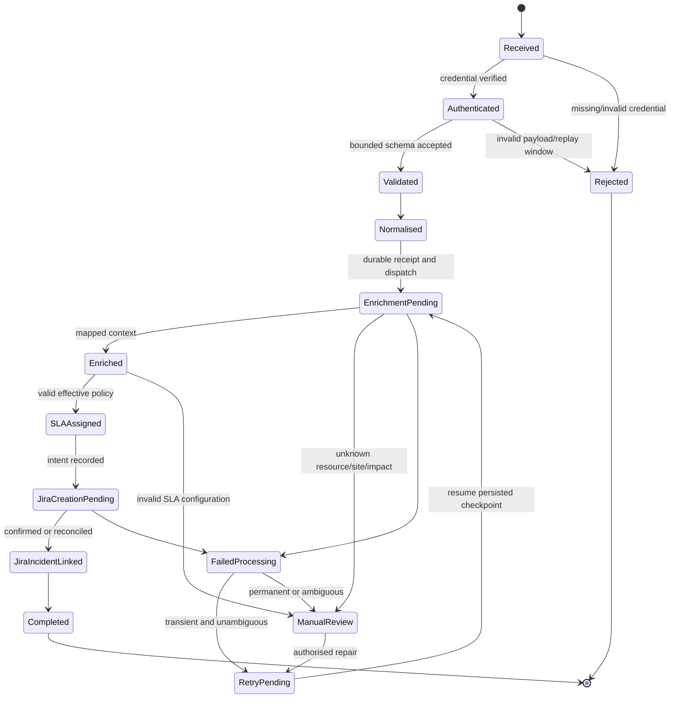
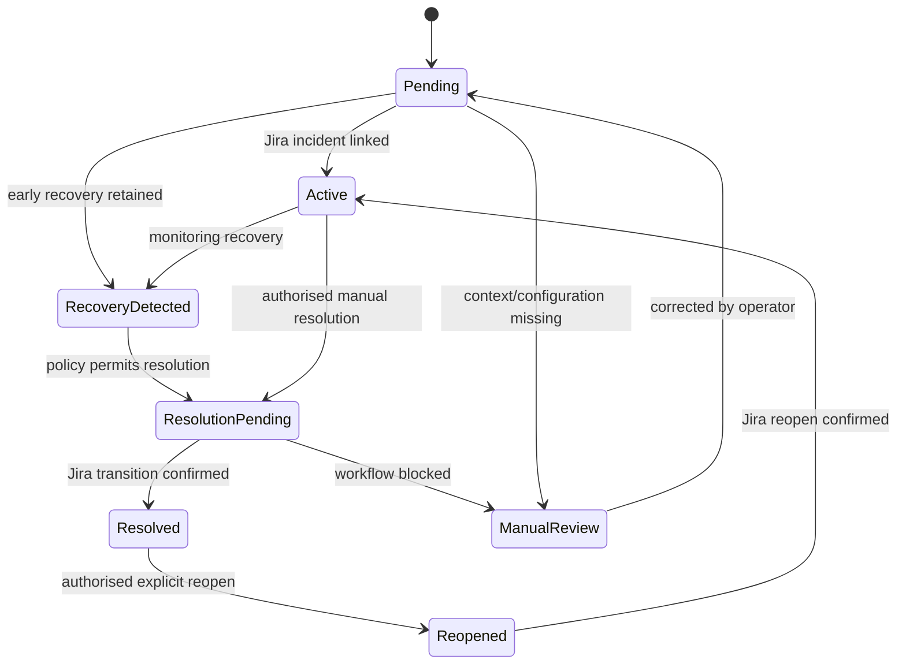

# Event processing and operational lifecycle

Design only. Delivery is at-least-once within documented retention, not exactly-once. The durable ledger is the source of processing truth, while Jira and Light House operational status need reconciliation.

Authenticated is a security decision before durable payload processing, not an incident state. Recovery/update events run a branch that loads the same problem aggregate and applies lifecycle transitions; they do not create another problem issue. Resume retries at the saved step, never rerun external writes blindly.

## Identity and ordering

Idempotency digest = SHA-256 of a canonical JSON tuple `[schemaVersion, tenantId, monitoringSourceId, externalEventId, eventKind]`. Tenant/source come from trusted credential configuration; event identifiers must be stable and length bounded. A recovery has its own stable event ID plus original problem ID; lifecycle aggregate key is `(tenant, source, problemEventId)`. Do not use message text, arrival time, delimiter concatenation, severity or credential version as identity. Rotation must not change event identity. Canonical tuple rules and digest collision handling need contract tests in Sprint 2.

A unique ledger insert suppresses duplicate delivery; subsequent handlers return the existing receipt without re-enrichment or Jira creation. Repeated problem notifications with new notification IDs must map to the stable problem event ID: append an update, retaining one incident and original SLA snapshot. Without trustworthy stable identity reject/manual-review rather than guess. Queue concurrency keys reduce parallel work; optimistic aggregate claims and unique keys remain authoritative.

## Failure and edge-case decisions

| Condition                             | Required behaviour / verification                                                                                                                                                                |
| ------------------------------------- | ------------------------------------------------------------------------------------------------------------------------------------------------------------------------------------------------ |
| Concurrent duplicate events           | One ledger key, conditional lease/version claim; others read receipt. Stress test with overlapping workers.                                                                                      |
| Recovery before problem processing    | Persist recovery against problem ID; wait for enrichment, create contextual JSM record if policy requires, then resolve. Never silently drop outage history.                                     |
| Out-of-order update/recovery          | Compare source event time/type and aggregate revision; preserve event history. Late problem cannot reactivate a recovered aggregate automatically. Implausible/future timestamps require review. |
| Jira create timeout / connection loss | Mark outcome ambiguous with intent marker. Search/reconcile before any retry; see below.                                                                                                         |
| Jira 429                              | Honour Retry-After, bounded backoff/jitter within retention, persist due time; do not block ingress.                                                                                             |
| Jira 400/401/403                      | Permanent configuration/permission failures to review; safe code only. No infinite retry.                                                                                                        |
| Partial integration failure           | Required JSM step remains incomplete; optional Zoho retry never undoes resolution. Repair missing mapping/audit writes from stable intent.                                                       |
| Unmapped resource / unknown site      | Quarantine safely, show source/event identifiers to authorised admins, require same-tenant mapping and explicit replay.                                                                          |
| Unknown customer impact               | Count is null with reason; apply explicit unknown-impact priority policy or manual review. Never treat unknown as zero.                                                                          |
| Invalid/missing effective SLA         | Block Jira creation by default pending operator policy repair; record error and configuration version.                                                                                           |
| Manual resolution                     | Verify Jira workflow permissions; record actor/reason and resolution UTC timestamp. Further repeat problem notices cannot reopen automatically.                                                  |
| Reopen / new outage                   | Same event requires explicit authorised reopen with separate SLA cycle snapshot; a new stable problem ID creates a new incident. Historical resolved snapshot is immutable.                      |
| Queue loss / exhausted retry          | Sweep ledger for stalled/undispatched states with bounded pages and attempt budget. Exhausted/ambiguous work becomes visible manual review.                                                      |
| Replay after retention                | Reject stale timestamps or require reviewed replay mode; minimal tombstones prevent duplicate new incidents.                                                                                     |

## Ambiguous Jira creation reconciliation

Persist an integration intent marker derived from internal incident ID before POST. Include it in a supported field on the initial create request (proposed dedicated marker custom field or exact token in description); adding a property only after creation is insufficient. Sprint 4 must verify which request fields are available for the selected JSM request type and which are searchable. Search within the configured project, candidate creation window and marker, then fetch candidate content and compare the complete marker. Eventually consistent search returning zero is not proof of failure.

If exactly one verified match exists, link it using the unique incident/issue mapping. Multiple matches need operator review. No match after repeated bounded checks still requires review or independently conclusive failed-create evidence before releasing another create attempt. Never automatically retry an unknown-outcome POST just because its lease expired. A confirmed pre-submission validation rejection can be corrected and retried. This trades some automation for preventing duplicate customer incidents without claiming external idempotency.

Duplicate-event suppression handles repeated identities only. Topology-aware correlation of several distinct uplink/site alerts is an optional later feature and must not be claimed by the MVP.
