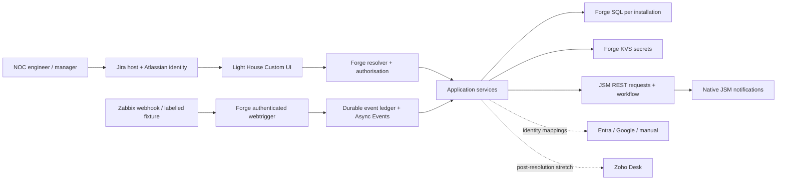

# System context

Future target architecture; only Custom UI/status resolver are implemented in Sprint 0.

Trust boundaries: public monitoring ingress; authenticated Atlassian UI/backend bridge; per-installation storage; logical ISP tenant; external provider REST APIs; JSM project visibility. Customer counts remain aggregate in Jira. Forge is the only backend. See tenancy and security for enforcement and capability assessment for verified API references.
